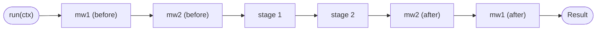

[← Documentation Map](README.md) · [Previous: 01 · Getting Started](getting-started.md) · [Next: 03 · AsyncStream and Backpressure →](async-streams-and-backpressure.md)

# 02 · Pipelines, Middleware, and Observability

This guide explains topological stage ordering (`before` / `after`), middleware layering and continuation rules, fail-fast error wrapping (`PipelineExecutionError`), and thread-safe metric collection (`PipelineStats`).

---

## Table of Contents

- [Stage Management and Topological Ordering](#stage-management-and-topological-ordering)
  - [Registration, Updates, Toggling, and Removal](#registration-updates-toggling-and-removal)
  - [Validation and Atomic Commits](#validation-and-atomic-commits)
- [Middleware Onion Model](#middleware-onion-model)
  - [Continuation (`next_`) Rules](#continuation-next_-rules)
  - [Short-Circuiting and Result Transformation](#short-circuiting-and-result-transformation)
- [Error Policy (`PipelineExecutionError`)](#error-policy-pipelineexecutionerror)
- [Observability (`PipelineStats` and Custom Observers)](#observability-pipelinestats-and-custom-observers)
- [Common Pitfalls](#common-pitfalls)

---

## Stage Management and Topological Ordering

Stages are ordered topologically using optional `before` and `after` constraints rather than strictly by insertion order. Registration order breaks ties among unconstrained nodes.

```python
from flowpipeline import Pipeline

pipeline = Pipeline[list[str]]()
pipeline.add("save", lambda log: [*log, "save"])
pipeline.add("validate", lambda log: [*log, "validate"], before="save")
pipeline.add("enrich", lambda log: [*log, "enrich"], after="validate", before="save")

assert pipeline.stage_names == ("validate", "enrich", "save")
assert pipeline.run([]) == ["validate", "enrich", "save"]
```

### Registration, Updates, Toggling, and Removal

| Action | Stage Method | Middleware Method | Behavior |
| --- | --- | --- | --- |
| Add callable | `add(name, fn, before=..., after=...)` | `add_middleware(name, fn, before=..., after=...)` | Names must be non-empty strings; duplicates raise `ValueError`, missing targets raise `KeyError`. |
| Decorator | `@pipeline.stage(name, ...)` | `@pipeline.middleware(name, ...)` | Registers and returns the original callable unchanged. |
| Replace | `replace(name, new_fn)` | `replace_middleware(name, new_fn)` | Updates callback while preserving ordering and enabled state. |
| Toggle | `enable(name)` / `disable(name)` | `enable_middleware(name)` / `disable_middleware(name)` | Adds/removes from the active plan while keeping ordering constraints intact. |
| Remove | `remove(name)` | `remove_middleware(name)` | Removes component and dangling references to it; returns the previous callable. |

### Validation and Atomic Commits

- All mutations follow a **copy-on-change** commit pattern. Introducing a cycle (`A` `before="B"`, `B` `before="A"`) or referencing an unknown name raises `ValueError` / `KeyError` without altering the existing plan.
- Middleware chains are capped at **64** entries (`_MAX_MIDDLEWARE_COUNT = 64`) to prevent excessive call-stack depth; exceeding the cap raises `ValueError`.

[Back to top](#table-of-contents)

---

## Middleware Onion Model

Stages execute sequentially (`stage_1 -> stage_2 -> stage_3`), while middleware layers wrap the execution chain from outermost to innermost:



### Continuation (`next_`) Rules

The `next_` continuation passed into middleware enforces strict safety invariants:

- **Single-use:** Calling `next_()` more than once within the same middleware invocation raises `RuntimeError`.
- **Call- and owner-scoped:** Retaining `next_` and invoking it after the middleware returns, or calling it from a different thread (`Pipeline`) or a different `asyncio.Task` (`AsyncPipeline`), raises `RuntimeError`.
- **Unawaited coroutine cleanup:** Inside `AsyncPipeline`, if a middleware creates a coroutine via `next_(ctx)` and exits without `await`-ing it, `close_unawaited()` closes it automatically in `finally` to prevent coroutine leaks and warnings.

### Short-Circuiting and Result Transformation

Returning a value directly without calling `next_(ctx)` **short-circuits** execution—inner middleware and stages are skipped cleanly.

[Back to top](#table-of-contents)

---

## Error Policy (`PipelineExecutionError`)

FlowPipeline never swallows failures silently:

- Any standard `Exception` raised inside a stage, middleware, or observer is wrapped into **`PipelineExecutionError`**, preserving the original exception as `__cause__`:
  - `error.name`: Name of the failing stage/middleware (`None` for `"run"` phase)
  - `error.phase`: `"stage"`, `"middleware"`, `"run"`, or `"observer"`
  - `error.context`: Input context active when failure occurred
  - `error.observer_errors`: Tuple of any exceptions raised by the observer *during* an already-failing run, ensuring instrumentation failures never mask the root cause.
- **Cancellation (`asyncio.CancelledError`):** Because `asyncio.CancelledError` is a `BaseException` rather than `Exception`, `AsyncPipeline` propagates cancellation directly without wrapping it into `PipelineExecutionError`. If an observer raises while recording cancellation, `CancelledError` remains raised with the observer error chained as its cause.

```python
from flowpipeline import Pipeline, PipelineExecutionError

pipeline = Pipeline[int]()
pipeline.add("step_1", lambda x: x + 1)
pipeline.add("boom", lambda x: 1 // 0 if x == 2 else x)

try:
    pipeline.run(1)
except PipelineExecutionError as err:
    assert err.phase == "stage"
    assert err.name == "boom"
    assert err.context == 2
    assert isinstance(err.__cause__, ZeroDivisionError)
```

[Back to top](#table-of-contents)

---

## Observability (`PipelineStats` and Custom Observers)

Pipeline timing is disabled by default. Attach `observer=PipelineStats()` or a custom synchronous `PipelineObserver` when you need measurements.

- Observers run inline on the caller’s thread or event loop. Keep them short, and move blocking logging or I/O out of the observer.
- `PipelineStats` is thread-safe. Reading `stats.snapshot` returns an immutable `PipelineStatsSnapshot` (`stages` and `middleware` are read-only `MappingProxyType` views), isolated from subsequent runs or `stats.reset()`.
- Pass `correlation_provider` (for example `flowevent.current_correlation_id`) to automatically populate `PipelineObservation.correlation_id`.

```python
from flowpipeline import AsyncPipeline, PipelineStats

stats = PipelineStats()
pipeline = AsyncPipeline[int](observer=stats)
# ... register stages and await runs ...
snap = stats.snapshot
# snap.runs -> ExecutionMetrics(calls, successful, failed, cancelled, total_seconds, max_seconds)
# snap.stages["name"], snap.middleware["name"]
```

[Back to top](#table-of-contents)

---

## Common Pitfalls

| Mistake | Why It Fails | Correct Approach |
| --- | --- | --- |
| Passing `async def` to `Pipeline` | Raises `TypeError` immediately; sync pipelines never run an event loop. | Use `AsyncPipeline` for coroutine callbacks. |
| Returning a non-awaitable directly from an `AsyncPipeline` stage | `AsyncPipeline` enforces awaitable returns (`TypeError`). | Mark every `AsyncPipeline` stage and middleware `async def`. |
| Calling `next_()` twice inside middleware | Protected by single-use enforcement (`RuntimeError`). | Implement retries at the stage level (e.g., with `flowcoord.RetryPolicy`) rather than re-invoking `next_`. |
| Returning an unawaited coroutine from a sync `Pipeline` stage | Caught by `synchronous_result()` (`TypeError`) and closed safely if it is a coroutine. | Ensure synchronous stages return plain data. |

[Back to top](#table-of-contents)

---

**Previous:** [01 · Getting Started and Architecture](getting-started.md) · **Next:** [03 · AsyncStream, Backpressure, and Lifecycle →](async-streams-and-backpressure.md)
