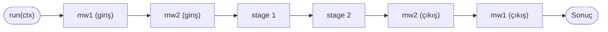

[← Belge Haritası](README.md) · [Önceki: 01 · Başlangıç](getting-started.md) · [Sonraki: 03 · AsyncStream ve Backpressure →](async-streams-and-backpressure.md)

# 02 · Pipeline, Middleware ve Gözlemlenebilirlik

Bu rehber aşama sıralamasını (`before` / `after`), ara yazılımların (middleware) çalışma sırasını ve kurallarını, hata sarmalama semantiğini (`PipelineExecutionError`) ve ölçüm toplamayı (`PipelineStats`) ayrıntılı olarak açıklar.

---

## Konu Dizini

- [Aşama Yönetimi ve Topolojik Sıralama](#aşama-yönetimi-ve-topolojik-sıralama)
  - [Kayıt, Güncelleme, Devre Dışı Bırakma ve Silme](#kayıt-güncelleme-devre-dışı-bırakma-ve-silme)
  - [Kısıtlar ve Atomik Doğrulama](#kısıtlar-ve-atomik-doğrulama)
- [Middleware Soğan (Onion) Modeli](#middleware-soğan-onion-modeli)
  - [Devamlılık (`next_`) Kuralları](#devamlılık-next_-kuralları)
  - [Kısa Devre (Short-Circuit) ve Yanıt Dönüştürme](#kısa-devre-short-circuit-ve-yanıt-dönüştürme)
- [Hata Politikası (`PipelineExecutionError`)](#hata-politikası-pipelineexecutionerror)
- [Gözlemlenebilirlik (`PipelineStats` ve Özel Observer)](#gözlemlenebilirlik-pipelinestats-ve-özel-observer)
- [Sık Yapılan Hatalar](#sık-yapılan-hatalar)

---

## Aşama Yönetimi ve Topolojik Sıralama

Aşamalar yalnızca eklenme sırasıyla değil, isteğe bağlı `before` ve `after` bağımlılıklarıyla topolojik olarak sıralanır. Aynı önceliğe sahip düğümlerde eklenme sırası korunur.

```python
from flowpipeline import Pipeline

pipeline = Pipeline[list[str]]()
pipeline.add("save", lambda log: [*log, "save"])
pipeline.add("validate", lambda log: [*log, "validate"], before="save")
pipeline.add("enrich", lambda log: [*log, "enrich"], after="validate", before="save")

assert pipeline.stage_names == ("validate", "enrich", "save")
assert pipeline.run([]) == ["validate", "enrich", "save"]
```

### Kayıt, Güncelleme, Devre Dışı Bırakma ve Silme

| İşlem | Aşama Metodu | Middleware Metodu | Davranış |
| --- | --- | --- | --- |
| Ekleme (fonksiyonla) | `add(name, fn, before=..., after=...)` | `add_middleware(name, fn, before=..., after=...)` | İsim boş olamaz; varsa `ValueError`, hedef yoksa `KeyError` verir. |
| Ekleme (dekoratör) | `@pipeline.stage(name, ...)` | `@pipeline.middleware(name, ...)` | Orijinal fonksiyonu değiştirmeden geri döndürür. |
| Değiştirme | `replace(name, new_fn)` | `replace_middleware(name, new_fn)` | Sırasını ve aktiflik durumunu koruyarak callback'i günceller. |
| Açma / Kapatma | `enable(name)` / `disable(name)` | `enable_middleware(name)` / `disable_middleware(name)` | Sıralama kısıtlarını silmeden yalnızca yürütme planından çıkarır/ekler. |
| Silme | `remove(name)` | `remove_middleware(name)` | Bileşeni ve diğer düğümlerin ona olan `before`/`after` referanslarını temizleyip eski callback'i döndürür. |

### Kısıtlar ve Atomik Doğrulama

- Her `add`, `replace`, `remove`, `enable`, `disable` işlemi **kopya-üzerinde-onayla (copy-on-change)** yaklaşımıyla çalışır. Döngü oluşturan bir sıralama (`A` `before="B"`, `B` `before="A"`) veya olmayan bir isim verilirse eski plan **hiç bozulmaz**, `ValueError` veya `KeyError` fırlatılır.
- Middleware sayısı derin çağrı yığını taşmasını önlemek için en fazla **64** ile sınırlandırılmıştır (`_MAX_MIDDLEWARE_COUNT = 64`). Sınırı aşan ekleme `ValueError` verir.

[Yukarı dön](#konu-dizini)

---

## Middleware Soğan (Onion) Modeli

Aşamalar ardışık (`stage_1 -> stage_2 -> stage_3`), middleware'ler ise aşamaların etrafında **iç içe katmanlar** hâlinde çalışır. En dıştaki middleware önce çalışır, `next_(value)` çağırdığında bir içteki katmana ve sonunda aşamalara geçilir, dönüşte ise ters sırada çıkar:



### Devamlılık (`next_`) Kuralları

Bir middleware'e verilen `next_` devamlılık nesnesi sıradan bir global fonksiyon değildir; üretim hatalarını önlemek için sıkı kurallarla korunur:

- **Tek kullanımlıktır:** Aynı middleware çalıştırması içinde `next_()` ikinci kez çağrılırsa `RuntimeError` fırlatır.
- **Çağrısına ve sahibine bağlıdır:** Middleware gövdesi döndükten sonra `next_` saklanıp sonradan çağrılamaz; ayrıca senkron kodda başka bir thread'den, asenkron kodda başka bir `asyncio.Task`'tan çağrılması `RuntimeError` ile reddedilir.
- **Asenkron güvenlik:** `AsyncPipeline` içinde bir middleware `next_(ctx)` ile coroutine oluşturup onu `await` etmeden çıkarsa, Python'da `"coroutine was never awaited"` uyarısı ve kaynak sızıntısı oluşmaması için bekletilmemiş coroutine `finally` bloğunda otomatik kapatılır (`close_unawaited()`).

### Kısa Devre (Short-Circuit) ve Yanıt Dönüştürme

Bir middleware `next_(ctx)` çağırmadan doğrudan bir değer döndürürse **kısa devre** gerçekleşir; içteki middleware'ler ve hiçbir stage çalıştırılmaz. Önbellekten dönme veya doğrulama reddi için idealdir.

[Yukarı dön](#konu-dizini)

---

## Hata Politikası (`PipelineExecutionError`)

FlowPipeline sessizce hata yutmaz ("fail-fast"):

- Bir `stage`, `middleware` veya `observer` içinde standart bir `Exception` oluşursa, hata **`PipelineExecutionError`** içine sarılır ve orijinal istisna `__cause__` olarak korunur:
  - `error.name`: Hatanın oluştuğu bileşenin adı (`run` fazında `None`)
  - `error.phase`: `"stage"`, `"middleware"`, `"run"` veya `"observer"`
  - `error.context`: O anki bağlam değeri
  - `error.observer_errors`: Zaten bir aşama/middleware hatası varken observer da çökerse, observer hataları ana hatayı **ezmeden** bu demet içinde toplanır.
- **İptal (`asyncio.CancelledError`) özel durumu:** `AsyncPipeline` çalışırken dışarıdan iptal edilirse `asyncio.CancelledError` (bir `BaseException`) `PipelineExecutionError` içine **sarılmaz**, doğrudan yukarı yayılır. Asenkron iptal sırasında observer da hata verirse `CancelledError` korunur ve observer hatası neden olarak eklenir.

```python
from flowpipeline import Pipeline, PipelineExecutionError

pipeline = Pipeline[int]()
pipeline.add("step_1", lambda x: x + 1)
pipeline.add("boom", lambda x: 1 // 0 if x == 2 else x)

try:
    pipeline.run(1)
except PipelineExecutionError as err:
    assert err.phase == "stage"
    assert err.name == "boom"
    assert err.context == 2
    assert isinstance(err.__cause__, ZeroDivisionError)
```

[Yukarı dön](#konu-dizini)

---

## Gözlemlenebilirlik (`PipelineStats` ve Özel Observer)

Pipeline süre ölçümü varsayılan olarak kapalıdır. Ölçüm gerektiğinde `observer=PipelineStats()` ya da kendi senkron `PipelineObserver` fonksiyonunu ver.

- Gözlemciler çağıran thread veya event loop üzerinde çalışır. Gözlemciyi kısa tut ve bloke eden loglama veya I/O işlerini başka yerde yap.
- `PipelineStats` thread güvenlidir. `stats.snapshot` özelliği o anın değişmez bir `PipelineStatsSnapshot` kopyasını döndürür (`stages` ve `middleware` salt-okunur `MappingProxyType`'tır); sonradan gelen `run()` çağrıları veya `stats.reset()` alınmış bir snapshot'ı değiştirmez.
- İstersen `correlation_provider` (ör. `flowevent.current_correlation_id`) vererek her `PipelineObservation` nesnesine otomatik `correlation_id` eklenmesini sağlayabilirsin.

```python
from flowpipeline import AsyncPipeline, PipelineStats

stats = PipelineStats()
pipeline = AsyncPipeline[int](observer=stats)
# ... aşamalar ve çalıştırma sonrası ...
snap = stats.snapshot
# snap.runs -> ExecutionMetrics(calls, successful, failed, cancelled, total_seconds, max_seconds)
# snap.stages["isim"], snap.middleware["isim"]
```

[Yukarı dön](#konu-dizini)

---

## Sık Yapılan Hatalar

| Hata | Neden Sorun Çıkarır? | Doğru Yaklaşım |
| --- | --- | --- |
| `Pipeline` içine `async def` aşama vermek | Kayıtta hemen `TypeError` verir; senkron pipeline event loop çalıştırmaz. | Coroutine aşamalar için `AsyncPipeline` kullan. |
| `AsyncPipeline` içinden bir stage'in `None` yerine awaitable olmayan düz değer döndürmesi | `AsyncPipeline` aşama ve middleware callback'lerinin awaitable döndürmesini zorunlu kılar (`TypeError`). | Tüm `AsyncPipeline` aşama ve middleware'lerini `async def` yap. |
| Middleware içinde `next_` fonksiyonunu iki kez çağırmak | Tek kullanımlık koruma nedeniyle `RuntimeError` yükseltilir. | Retry/tekrar çalıştırma gerekiyorsa bunu ara yazılım içinde `next_` yerine `flowcoord.RetryPolicy` gibi araçlarla aşama düzeyinde uygula. |
| `stage(x)` sonucunun `async def` aşamadan yanlışlıkla bir coroutine döndürmesi | Çifte await yapılmamışsa `synchronous_result` bunu yakalar ve `TypeError` fırlatır. | Döndürülen sonucun düz veri olduğundan emin ol. |

[Yukarı dön](#konu-dizini)

---

**Önceki:** [01 · Başlangıç ve Mimari Felsefe](getting-started.md) · **Sonraki:** [03 · AsyncStream, Backpressure ve Yaşam Döngüsü →](async-streams-and-backpressure.md)
